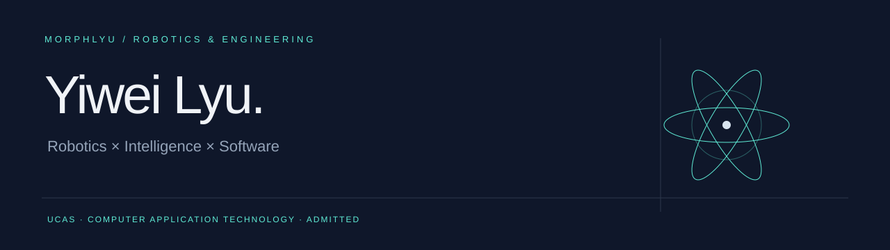
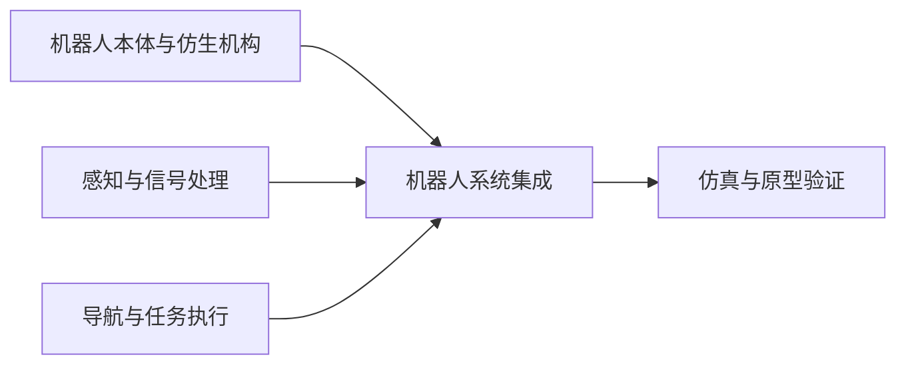

# 吕怡纬 · Yiwei Lyu

**已推免至中国科学院大学计算机应用技术专业**，本科就读于郑州大学人工智能拔尖创新班，关注 **机器人、算法与智能硬件**。研究与工程实践涉及跨介质栖息、仿生末端执行器、ROS 自主导航和机器人交互。

**[个人网站](https://morphlyu.github.io/MorphLyu/)** · **[GitHub 项目档案](PROJECTS.md)** · **[CampusFly 源码](https://github.com/MorphLyu/CampusFly-UAV)** · **[已发表论文](https://doi.org/10.11993/j.issn.2096-3920.2025-0107)** · **[联系我](mailto:lyumechanics@163.com)**

## Selected work

| 项目 | 工程问题与工作 | 作品入口 |
| :--- | :--- | :--- |
| 精卫 · 跨介质栖息无人机 | 仿生双稳态“抓取—吸附”机构；主导末端机构设计 | [项目档案](PROJECTS.md#jingwei) · [公开专利](https://patents.google.com/patent/CN120370973A/zh) |
| CampusFly · 校园无人机配送 | ROS Noetic / Gazebo 仿真、move_base 导航、SLAM 与多航点任务 | [代码与运行说明](https://github.com/MorphLyu/CampusFly-UAV) |
| 可重构多模态末端执行器 | 线控抓取、外扩、吸附与包裹的多构型设计和操作验证 | [项目档案](PROJECTS.md#gripper) |
| 六驱全向矢量水下机器人 | 总体机械构型、推进器布局、流体仿真与控制集成 | [项目档案](PROJECTS.md#rov) |
| EVE · 人形表情交互机器人 | 团队项目：语言、流式语音、跨模态表情预测与机构执行 | [项目档案](PROJECTS.md#eve) |
| EMG · 肌电控制仿生义肢 | 团队项目：肌电信号、PaddlePaddle / LSTM 与 3D 打印义肢 | [项目档案](PROJECTS.md#emg) |
| 移动底盘 · 轮椅机器人改造 | ROS、激光雷达 / SLAM、深度相机与 ESP32 控制链路 | [项目档案](PROJECTS.md#wheelchair) |

## Engineering connections

工程实践接触的工具与方法：**Python / ROS / Gazebo / SolidWorks / Ansys / 嵌入式 / 3D 打印**。各技术对应的实际项目与参与范围见项目档案。

## Research & recognition

- **第一作者论文已发表**：水下软体抓取手研究现状及应用展望，*水下无人系统学报*，2025，33(5): 769–779。[DOI](https://doi.org/10.11993/j.issn.2096-3920.2025-0107)
- **发明专利授权**：基于仿生机器人的水域污染监测治理一体化平台，第三发明人，ZL 2025 1 1774088.7。
- **国家级一等奖**：“挑战杯”全国大学生课外学术科技作品竞赛、中国机器人及人工智能大赛、中国机器人大赛暨 RoboCup 中国赛。
- **国家级二等奖**：中国高校计算机大赛人工智能创意赛，EMG 仿生义肢团队成员，个人排名第 3。

在研/在审稿件与已发表论文分开记录。科研项目档案展示工程方案与原型，不代表全部项目已开放源代码。

---

欢迎交流机器人、算法与智能硬件的实习及工作机会。 **[lyumechanics@163.com](mailto:lyumechanics@163.com)**
